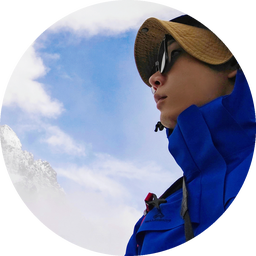
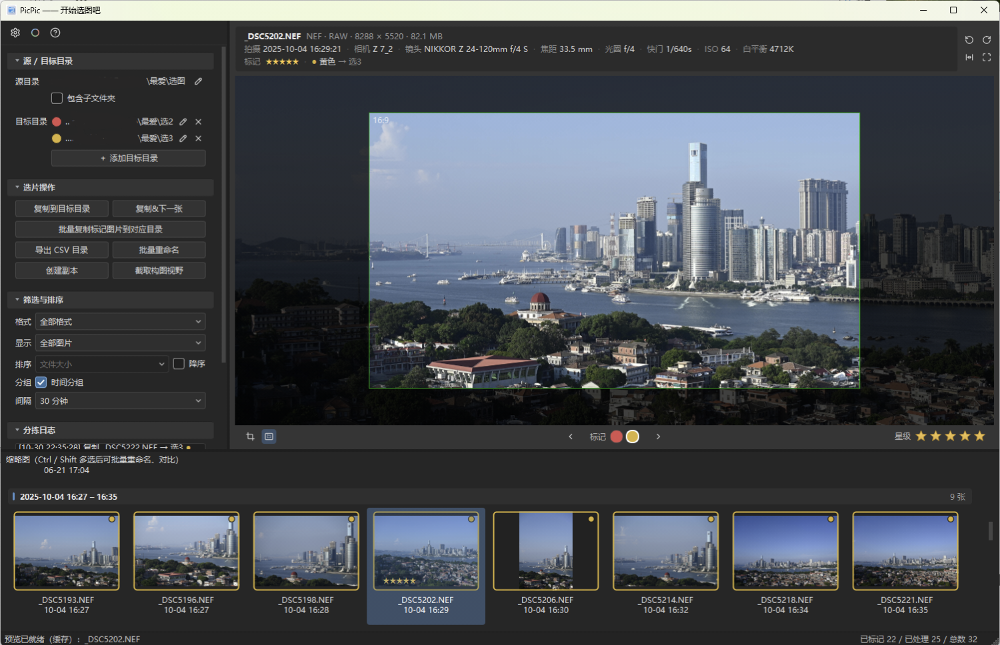
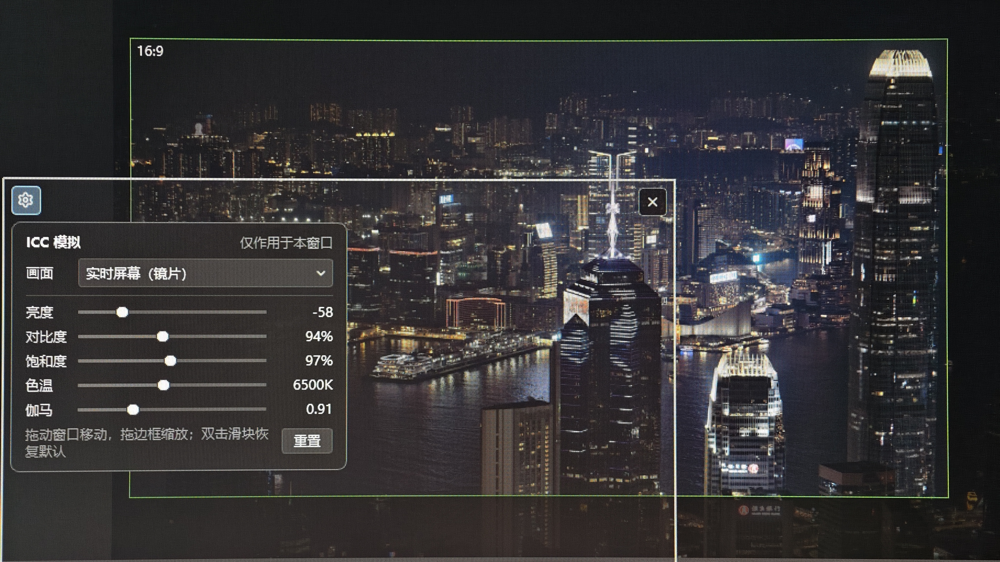

<p align="center">
  
</p>

<h1 align="center">PicPic</h1>
<p align="center">快速选图工作台</p>

<p align="center">
  
  　抖音 / 小红书 ID：二仙桥热心市民　·　邮箱：1563535490@qq.com
</p>

<p align="center">
  <a href="https://github.com/wanshubin/PicPic/releases/latest">下载便携版</a> ·
  <a href="https://github.com/wanshubin/PicPic">GitHub</a> ·
  <a href="#界面预览">界面预览</a> ·
  <a href="#功能">功能</a> ·
  <a href="#使用流程">使用流程</a> ·
  <a href="#快捷键">快捷键</a> ·
  <a href="#构建">构建</a> ·
  <a href="#许可">GPLv3</a>
</p>

PicPic 是一个面向 **RAW 高速挑片** 的桌面工作台：扫描目录、看大图、打星级、
按颜色标记去向，再把选中的照片按颜色**分别复制**到多个目标文件夹。
预览面板还提供只影响显示、不修改文件的**固定视野构图辅助框**，用来快速评估二次构图。

它不提供修图、调色或成品导出——打开就是快速选图工作台，用完即走，原片一个字节都不动。

- **快速过片**：缩略图网格 + 大图预览，方向键逐张看，空格复制并跳到下一张。
- **多目录分拣**：每个目标目录对应一种颜色，批量复制时按颜色自动分发到各自目录。
- **不碰原片**：星级、颜色标记与分拣日志只写在源目录下的侧车文件里，不修改 RAW / EXIF。
- **构图辅助**：固定视野取景框、比例、压暗与三分线只作用于预览，不改文件、不生成裁切。
- **ICC 模拟**：悬浮窗实时模拟亮度、对比度、饱和度、色温与伽马，方便判断照片在不同显示条件下的观感。
- **免安装可用**：提供便携压缩包，解压双击即可运行，不需要安装 Qt 或 VC++ 运行库。

---

## 界面预览

<p align="center">
  <a href="screenshot/选图界面.png">
    
  </a>
</p>
<p align="center"><sub>主界面：左侧目录与筛选，中间固定视野构图框，下方是按拍摄时间分组的缩略图。</sub></p>

<p align="center">
  <a href="screenshot/按下空格快速选图&amp;查看下一张.png">
    
  </a>
</p>
<p align="center"><sub>未标记的照片按下空格即弹出色板：← → 选颜色，松手后复制并切到下一张；最左边「无」表示不标记。</sub></p>

<p align="center">
  <a href="screenshot/ICC模拟.jpg">
    
  </a>
</p>
<p align="center"><sub>ICC 模拟器：把悬浮窗拖到画面上，实时查看亮度、对比度、饱和度、色温与伽马的效果，参数只作用于这个窗口。</sub></p>

---

## 功能

| 分类 | 内容 |
|---|---|
| 目录与扫描 | 源目录选择、手动输入、启动参数传入文件 / 目录、重启恢复上次目录；默认不递归，可勾选包含子文件夹；源目录变化后自动刷新（800ms 防抖） |
| 支持的格式 | RAW：DNG / CR2 / CR3 / CRW / NEF / NRW / ARW / SR2 / SRF / RAF / RW2 / ORF / PEF / RWL / 3FR / FFF / IIQ（libraw），X3F 可扫描预览；普通位图：JPG / JPEG / PNG / TIF / TIFF / WebP / BMP |
| 缩略图网格 | 默认读取相机内嵌 JPEG，整目录挑片最快；可在设置里切换「缩略图展示为RAW」，让缩略图色彩与主预览一致；显示文件名、拍摄时间，以及星级 / 颜色角标，悬停可看尺寸、文件大小与目标目录；支持 Ctrl / Shift 多选，用于批量重命名和创建副本 |
| 大图预览 | 默认显示相机内嵌 JPEG，可切换为软件渲染；滚轮缩放（围绕光标）、拖动平移、双击 / 「适合窗口」复位；放大超过预览分辨率后按需生成 1:1 细节并保留当前视图；支持全屏 |
| 图片信息栏 | 文件名、格式、尺寸、文件大小、拍摄时间、相机、镜头、焦距、光圈、快门、ISO、白平衡；有数据时另起一行显示对焦距离、测光模式、GPS；当前星级与颜色标记对应目标目录 |
| 评级与标记 | 一排扁平五角星（悬停预览、点击落定、再点当前星级清除）、颜色标记圆点（点击标记 / 再点取消）、快捷键 0~5 与 X |
| 空格快速选片 | 未标记照片按下空格即弹出色板，← → 选颜色、松手复制并下一张；已标记照片短按空格直接复制，按住 1 秒可重新选色；最左边「无」清除标记 |
| 分拣复制 | 单个复制 / 复制 + 下一张 / 批量复制标记；目标目录已有相同图片时跳过复制，同名但内容不同才追加 `_1`、`_2`…；目标目录不存在时询问创建；禁止复制到源目录；复制写入分拣日志 |
| 分拣日志 | 左侧实时显示复制、跳过、删除记录；最多保留 500 条，面板显示最近 200 条，可一键清空 |
| 批量工具 | 导出选片 CSV；按前缀批量重命名源文件（保留原扩展名，标记随文件迁移）；为选中图片创建副本；截取构图视野 |
| 筛选、排序与时间分组 | 按格式（全部 / RAW / 普通图片）、星级（1~5 星及以上 / 5 星 / 已标记颜色 / 未标记颜色）筛选；按文件名 / 拍摄时间 / 文件大小排序并可降序；时间分组按相邻拍摄间隔自动分栏（1 分钟 ~ 1 天），标题显示起止时间与张数，点击左侧三角可折叠 / 展开整组 |
| 构图辅助 | 固定居中的取景框、预设 / 自定义比例、1px 框线颜色、框外压暗 40%~100%、压暗开关、比例文字、三分构图线；支持仅预览旋转 90°、全屏预览 |
| ICC 模拟器 | 无边框悬浮窗，可拖到画面上或拖边框缩放；画面来源可选「实时屏幕（镜片）」或「测试色卡」；亮度、对比度、饱和度、色温、伽马五个参数实时生效；双击滑块或点「重置」恢复默认 |
| 设置与帮助 | 「缩略图展示为RAW」、镜头畸变校正开关、常用快捷键改键 / 清除；左侧面板各分组可折叠，界面状态自动保存；顶部「帮助」提供功能介绍、标准工作流示例与联系方式 |
| 数据与安全 | 标记与日志只写侧车 JSON；侧车解析失败时给出提示；复制不覆盖已有文件；目标目录写权限不足会明确提示 |

---

## 使用流程

1. **选择源目录**：点「…」选择照片所在文件夹；需要扫子目录时勾选「包含子文件夹」。
2. **配置目标目录**：点「＋ 添加目标目录」选择复制去向，可以有多个目录；
   每个目录会自动分配一种标记颜色（最多 10 个）。目录行右侧的铅笔图标可更改路径。
3. **挑片**：
   - 用 `←` / `→` 逐张看，`F` 全屏；
   - 点右下角星星评级（1~5 星，再点当前星级清除）；
   - 点预览下方的颜色圆点标记去向；
   - 未标记的照片按 `Space` 弹出色板，选好颜色松手即复制并切到下一张；
     已标记的照片直接短按 `Space` 就复制并下一张，按住 1 秒可改标记。
4. **批量分拣**：点「批量复制标记图片到对应目录」，**整个源目录**中所有带颜色标记的图片
   （包括被当前筛选条件隐藏的图片）会按颜色复制到各自目录；
   带进度条，可取消，完成后显示成功 / 失败 / 跳过数量。
5. **复盘**：左侧「分拣日志」查看复制记录；「导出 CSV 目录」导出完整选片清单；
   需要留档时用「截取构图视野」保存取景框内的画面。

> 没有当前图片时，评级与颜色圆点会整体压暗禁用。批量复制只处理带颜色标记的图片，
> 与缩略图当前是否可见无关。

---

## 评级、颜色与目标目录

### 星级

- 0~5 星，点击第 N 颗星 = N 星；再点当前星级 = 清除。
- 鼠标悬停时整排按悬停位置预览填充，点击后落定。
- 快捷键 `1`~`5` 设置星级，`0` 清除。
- 星级写入侧车文件的 `star` 字段，不影响原片。

### 颜色标记

颜色圆点在预览下方，**数量始终等于目标目录数量**，颜色与左侧目标目录行一一对应：

| 顺序 | 颜色 | 英文名（写入侧车） |
|---|---|---|
| 1 | 红色 | `Red` |
| 2 | 黄色 | `Yellow` |
| 3 | 绿色 | `Green` |
| 4 | 蓝色 | `Blue` |
| 5 | 紫色 | `Purple` |
| 6 | 青色 | `Cyan` |
| 7 | 橙色 | `Orange` |
| 8 | 粉色 | `Pink` |
| 9 | 棕色 | `Brown` |
| 10 | 灰色 | `Gray` |

- 点圆点给当前图片标记颜色；再点同一个圆点或按 `X` 取消标记。
- 缩略图用目标色边框和颜色角标提示归属；信息栏显示「● 颜色 → 目标目录名」。
- 颜色只是分拣标签，不会涂改图片。

### 空格：复制并下一张

`Space` 是挑片时最常用的键，按当前图片是否已有标记分成两种操作：

- **未标记**：按下空格立即弹出色板，用 `←` / `→` 选择颜色（最左边「无」表示不标记），
  松开空格即按所选颜色复制并切到下一张；也可以直接用鼠标点选颜色。
- **已标记**：短按空格按当前标记复制并下一张；按住超过 1 秒弹出色板，可以改色，
  默认停在当前颜色上，松开后按新颜色复制并下一张。
- `Esc` 取消本次操作；点到色板外面也会取消。

### 目标目录与复制规则

- 目标目录列表初始一个，可继续添加（最多 10 个，受颜色数量限制）；
  每行显示颜色圆点、路径、「…」更改、「×」移除。
- 只有一个目标目录时，**未标记图片**在单张复制（`Space` / 「复制到目标目录」）时
  会直接复制到该目录，兼容单目录用法；批量复制仍然只处理带颜色标记的图片。
  有多个目录时，未标记图片不会复制，避免错投。
- 标记颜色没有对应目标目录的图片**不会兜底**，复制时跳过并写入日志。
- 复制前会先比较文件大小并逐字节核对内容：目标目录里已有**内容完全相同**的副本时
  跳过复制，不重复生成；只是文件名相同而内容不同（两张不同的照片）则追加
  `_1`、`_2`…，绝不覆盖目标目录中的已有文件。
- 改 / 清颜色标记时，旧目标目录中的副本会一并删除；如果新标记仍指向同一个目录，
  副本保留不动，不会出现“删掉再复制一遍”的冗余操作。
- **移除目标目录会清除这个颜色下的所有图片标记**，但已经复制出去的文件不会删除；
  重新添加目录后需要重新标记。
- 目标目录不存在时会询问是否创建；目标目录不能与源目录相同。
- 复制是原样搬运（RAW 不转码），源文件保留。

---

## 构图辅助（仅预览）

开启「固定视野」后，画布中央会显示一个**位置和大小固定**的取景框，框外压暗；
拖动 / 缩放只移动底层图片，因此可以把主体挪进框内，快速评估二次构图。

- 比例：3:2、4:3、16:9、1:1、2.39:1、2:3、3:4、4:5、9:16、自定义；
- 框线：固定 1px，可自选颜色；
- 框外压暗：40%~100%，默认 75%，可一键关闭压暗（`M`）而保留框与辅助线；
- 比例文字、三分构图线可单独开关；
- 视图旋转 90°（仅预览，不写入文件）、适合窗口、全屏。

构图框是纯视觉叠加层：**不修改图像、不生成裁切文件**。

需要留档时可用「截取构图视野」把取景框内的画面（不含面板、框线与压暗，窗口分辨率）
直接保存到原图所在目录，文件名为「原名_composition_编号.jpg」，不会覆盖原图。

---

## ICC 模拟器

从顶部工具栏的 ICC 图标打开。它是一个独立的无边框悬浮窗，可以拖到主界面的画面上，
用来快速判断照片在偏亮、偏暗、偏色等显示条件下的观感。

- **画面来源**：实时屏幕（镜片）会显示窗口下方那块屏幕内容；测试色卡提供
  24 色块、灰阶与 RGB 渐变，方便观察参数变化。
- **可调参数**：亮度（-100 ~ +100）、对比度（50% ~ 150%）、饱和度（0% ~ 200%）、
  色温（2000K ~ 12000K）、伽马（0.50 ~ 2.00，默认 1.00）。
- **操作**：拖动窗口移动，拖边框缩放；左上角齿轮展开参数面板，右上角关闭或按 `Esc`；
  双击任意滑块恢复该参数默认值，点「重置」恢复全部参数。
- **作用范围**：只影响这个悬浮窗，不改主预览、缩略图和导出结果，也不会写入文件。
- **截图提示**：这个悬浮窗在系统截图 / 录屏中不可见（Windows 10 2004 及以上；
  更早系统会显示为黑块），属于正常现象。

---

## 快捷键

| 快捷键 | 功能 |
|---|---|
| `←` / `→` | 上一张 / 下一张 |
| `↑` / `↓` | 在缩略图网格中按行上下移动 |
| `Space` | 复制并下一张；未标记照片按下即弹出色板，已标记照片按住 1 秒可改色 |
| `1` ~ `5` | 设置星级 |
| `0` | 清除星级 |
| `X` | 清除当前图片的颜色标记 |
| `R` | 开关固定视野构图 |
| `M` | 开关框外压暗遮罩 |
| `F` | 全屏预览 / 退出全屏 |
| `Esc` | 退出全屏 / 收起面板 / 取消色板 |
| `Ctrl` + `1`~`5` | 切换构图比例（3:2 / 4:3 / 16:9 / 1:1 / 2.39:1） |
| 滚轮 | 预览缩放（围绕光标） |
| 拖动 | 预览平移 |
| 双击预览 | 适合窗口 |

> 评级用数字键、构图比例用 `Ctrl` + 数字键，两套快捷键互不冲突。
> 上表中除 `0`~`5`、`Ctrl` + `1`~`5` 与 `Esc` 外，其余挑片快捷键都可以在「设置」面板里改键或清除。

---

## 数据与文件

### 侧车标记

每张图片的星级、颜色标记与复制日志保存在**源目录**下的 `.rawedit.pick.json`，
键为相对源目录的路径（递归扫描时同一个侧车覆盖整棵目录树），
原片与 EXIF 不会被修改。文件结构示例：

```json
{
  "version": 1,
  "files": {
    "2026-10/IMG_0001.NEF": { "star": 5, "label": "Red" },
    "IMG_0002.CR3": { "star": 3, "label": "Green" }
  },
  "log": [
    {
      "time": "2026-10-27 21:30:00",
      "action": "复制",
      "source": "D:/Photos/2026-10/IMG_0001.NEF",
      "target": "E:/精选/IMG_0001.NEF"
    }
  ]
}
```

- 分拣日志最多保留 500 条，日志面板显示最近 200 条，可一键清空。
  日志动作包括「复制」「跳过」「删除」：跳过表示目标目录里已有内容相同的副本，未重复写入。
- 侧车解析失败时，本次不会加载历史标记，并在日志中提示；此后继续打标会以当前
  内存状态重写侧车，若原文件损坏且需要保留，请先备份再操作。

### 其他数据位置

| 项 | 位置 |
|---|---|
| 设置（源目录、目标目录与颜色、筛选、构图参数、ICC 参数、快捷键、左侧面板折叠状态） | `QSettings`；Windows 为注册表 `HKCU\Software\PicPic\PicPic` |
| 应用日志 | Windows：`%APPDATA%\PicPic\PicPic\logs\picpic.log`；Linux：`~/.local/share/PicPic/PicPic/logs/picpic.log` |
| 选片 CSV | 由「导出 CSV 目录」选择保存位置，默认源目录下 `yyyyMMdd_pick.csv`（当天日期），UTF-8 BOM；中文表头，包含文件名、挑选状态、星级、颜色标记、目标目录、尺寸、拍摄时间、文件大小以及完整的 EXIF / GPS 字段；挑选状态按是否有颜色标记判断（有标记为「选中」） |

> 便携版（存在 `portable.ini`）的设置改为程序目录下的 `PicPic/PicPic.ini`，
> 日志写入程序目录的 `logs/`，不会写注册表。

---

## 已知限制

1. **只做挑片**：没有修图、调色、RAW 转码或成品导出；复制就是原样搬运文件。
2. **构图辅助不生成裁切**：「截取构图视野」保存的是取景框内的预览画面（窗口分辨率，
   不含 UI、框线与压暗），不是原图分辨率的裁切结果。
3. **1:1 细节需要时间**：放大到预览像素不足时会按原图分辨率重新渲染，
   大尺寸 RAW 约需数秒，期间状态栏会提示。
4. **缩略图来源不同**：默认使用相机内嵌 JPEG，几何与色彩可能与软件渲染预览略有差异；
   需要完全一致时勾选「缩略图展示为RAW」，代价是明显变慢。
5. **镜头校正依赖数据库**：随附的镜头数据库可能不包含较新镜头；
   未匹配时会跳过校正并给出提示。
6. **批量重命名不可撤销**：操作前有确认框，但重命名后无法自动恢复；侧车标记会同步迁移。
7. **目标目录最多 10 个**：由标记颜色数量决定；移除目录时，这个颜色下的图片标记
   会一并恢复为未标记，已经复制出去的文件不受影响。
8. **特殊 RAW 支持有限**：X-Trans 等非 2×2 阵列可以预览，但去马赛克效果可能与
   厂商软件不同；线性 DNG（已去马赛克）不支持。
9. **不写入 EXIF / XMP**：所有标记只在侧车 JSON 中，换一台机器挑片时请连同侧车一起带走。
10. **ICC 窗口不进截图**：ICC 模拟器悬浮窗会被系统排除在截图 / 录屏之外，
    无法用 `Win` + `Shift` + `S` 等工具截到；参数也只作用于该窗口，不影响主预览和导出。

---

## 构建

### 已验证环境

| 项 | 版本 |
|---|---|
| 系统 | Windows 11 x64 |
| 编译器 | MSVC 2022（19.44 / 14.44，BuildTools） |
| Qt | 6.8.3（msvc2022_64） |
| CMake | ≥ 3.21（Ninja） |
| 依赖 | libraw / lcms2 / lensfun / exiv2（vcpkg manifest，`x64-windows`） |
| 测试 | `ctest` 2/2 通过（`pipeline_smoke`、`core_units`） |

### Windows（vcpkg + Qt 官方安装器）

Qt 建议用官方安装器提供，libraw / lcms2 / lensfun / exiv2 交给 vcpkg：

```bat
:: 1) 准备 vcpkg（只需一次）
git clone https://github.com/microsoft/vcpkg.git C:/dev/vcpkg
C:/dev/vcpkg/bootstrap-vcpkg.bat

:: 2) 配置（manifest 模式会自动安装 vcpkg.json 中的依赖）
call "C:\Program Files (x86)\Microsoft Visual Studio\2022\BuildTools\VC\Auxiliary\Build\vcvars64.bat"

cmake -B build -G Ninja ^
  -DCMAKE_BUILD_TYPE=Release ^
  -DCMAKE_PREFIX_PATH="C:/Qt/6.8.3/msvc2022_64" ^
  -DCMAKE_TOOLCHAIN_FILE="C:/dev/vcpkg/scripts/buildsystems/vcpkg.cmake" ^
  -DVCPKG_TARGET_TRIPLET=x64-windows ^
  -DRAWCore_BUILD_TESTS=ON

:: 3) 编译
cmake --build build --parallel
```

产物：

- `build/bin/picpic.exe`
- 同目录下的 Qt DLL（`windeployqt` 自动部署）与 `lensfun/version_1` 镜头数据库
- 测试程序：`build/bin/test_pipeline.exe`、`build/bin/test_core_units.exe`

运行：

```bat
build\bin\picpic.exe
build\bin\picpic.exe D:\Photos\2026-10
```

### CMake 参数

| 参数 | 默认 | 说明 |
|---|---|---|
| `BUILD_WITH_LENSFUN` | `ON` | 是否编译镜头校正；`OFF` 时逻辑自动跳过（旧变量 `RAWCore_HAS_LENSFUN` 仍兼容） |
| `RAWCore_BUILD_TESTS` | `OFF` | 构建并注册 CTest 测试 |
| `RAWCore_WARNINGS_AS_ERRORS` | `OFF` | 把编译器警告视为错误 |
| `CMAKE_MSVC_RUNTIME_LIBRARY` | 由 vcpkg 三元组决定 | 配置阶段会检查 `/MD` 与 `/MT` 是否混用 |
| `VCPKG_TARGET_TRIPLET` | — | 动态用 `x64-windows`，静态用 `x64-windows-static` |

### 测试

```bat
ctest --test-dir build --output-on-failure
```

- `pipeline_smoke`：渲染管线的冒烟测试。
- `core_units`：核心工具函数、数据读写与镜头数据库查找的单元测试。

### 免安装压缩包（便携版）

动态链接构建可以直接打成绿色压缩包：

```bat
cmake --build build --target package-portable
```

生成的 `build/dist/PicPic-0.1.0-win64-portable.zip` 解压后双击 `picpic.exe`
即可运行，用户不需要安装 Qt、VC++ 运行库或任何开发环境。包内包含：

- `picpic.exe`、Qt / libraw / exiv2 / lensfun / lcms2 的运行期 DLL；
- `platforms`、`styles`、`iconengines`、`imageformats` 四个必需的 Qt 插件目录；
- `lensfun/` 镜头数据库与 CC-BY-SA 3.0 许可文本；
- VC++ 2015–2022 x64 运行库（app-local 部署，无需另外安装）；
- `LICENSE`、`NOTICE.txt`、`便携版说明.txt`。

包内的 `portable.ini` 是便携模式标记：存在时设置写入程序目录下的
`PicPic/PicPic.ini`，日志写入 `logs/`，不写注册表；删除该文件后回到系统用户目录。
因此请把包解压到有写权限的位置（桌面、U 盘等），不要直接放进 `Program Files`。

> 打包白名单在 `cmake/PackagePortable.cmake` 中维护；新增依赖 DLL 时需要同步。

### 静态打包（单 exe）

需要**静态编译的 Qt**，并使用 `x64-windows-static` 三元组（`/MT`）：

```bat
cmake -B build-static -G Ninja ^
  -DCMAKE_BUILD_TYPE=Release ^
  -DCMAKE_PREFIX_PATH="C:/Qt-static" ^
  -DCMAKE_TOOLCHAIN_FILE="C:/dev/vcpkg/scripts/buildsystems/vcpkg.cmake" ^
  -DVCPKG_TARGET_TRIPLET=x64-windows-static

cmake --build build-static --parallel
cmake --build build-static --target package-static
```

`package-static` 会把 exe、`LICENSE`、`NOTICE.txt` 与 lensfun 数据库整理到
`build-static/package/`。动态构建也可以使用 `deploy` 目标检查运行期依赖。

### Linux

```bash
sudo apt install build-essential cmake ninja-build qt6-base-dev libqt6concurrent6 \
     libraw-dev liblcms2-dev liblensfun-dev libexiv2-dev
cmake -B build -G Ninja -DCMAKE_BUILD_TYPE=Release
cmake --build build --parallel
./build/bin/picpic
```

Linux 下 lensfun 会依次查找 `/usr/share/lensfun/version_1`、
`/usr/local/share/lensfun/version_1` 等路径；Windows 下优先使用 exe 旁的
`lensfun/version_1`，也可用环境变量 `RAWEDIT_LENSFUN_DB` 指向自定义数据库。

> 未找到 lensfun 数据库时，程序会在日志与状态栏提示，并自动跳过镜头校正，其余功能不受影响。

---

## 反馈

遇到问题或有功能建议，欢迎在 [GitHub Issues](https://github.com/wanshubin/PicPic/issues) 提出。
也可以在小红书 / 抖音找到我：二仙桥热心市民，或发邮件到 1563535490@qq.com。

---

## 许可

本项目以 **GPLv3** 发布，许可证全文见 [`LICENSE`](LICENSE)；
第三方库许可见 [`third_party/NOTICE.txt`](third_party/NOTICE.txt)。

- Qt6（GPLv3）
- libraw（LGPL 2.1）
- lcms2（MIT）
- lensfun（LGPL 3.0）
- exiv2（GPL-2.0-or-later）
- lensfun 镜头数据库（CC-BY-SA 3.0）
